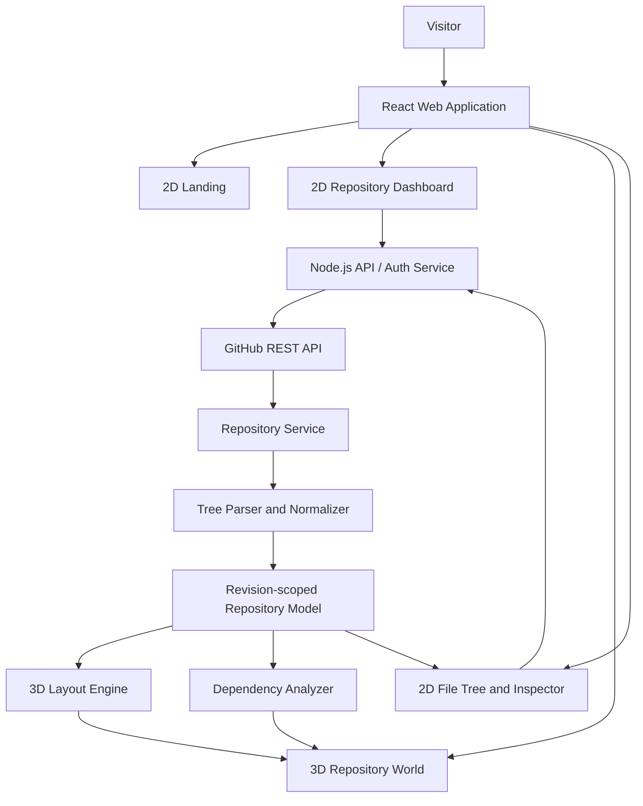

# 02 — System Architecture

## 1. Architecture principles

1. **GitHub is the source of truth.** Do not duplicate source code or repository state without a defined need.
2. **Revision consistency is mandatory.** A loaded repository model is bound to a commit SHA.
3. **2D first, 3D after selection.** The 3D scene is a feature area of the same web application.
4. **Separate data from presentation.** Scene coordinates are derived from repository data and are not canonical metadata.
5. **Secure privileged access server-side.** OAuth secrets and protected tokens must not be exposed to the browser.
6. **Progressive enhancement.** Repository navigation remains useful when WebGL is unavailable.
7. **Truthful analysis.** Unresolved imports and unsupported semantics must remain explicit.

## 2. Logical architecture

## 3. Recommended stack

### Frontend
- TypeScript, Vite
- IWSDK (`@iwsdk/core`) with Three.js and ECS systems
- UIKitML panels for spatial UI; DOM overlays where 2D text dominates
- A syntax-highlighting library for source inspection
- Node's built-in test runner for unit tests (see `09-testing-and-acceptance.md`)

### Backend
- Node.js with Fastify or Express
- GitHub OAuth / GitHub App integration, chosen after permission requirements are finalized
- Server-side session storage; use an appropriate persistent store only if deployment requires it
- Input validation and structured logging with secret redaction

### Optional later services
- Durable database for cross-device recents and user preferences
- Job queue for expensive repository analysis
- Object/cache storage for large, revision-scoped analysis results
- Language server or parser service for deeper symbol analysis

Do not add a database, queue, or microservice architecture to the first prototype without a requirement that justifies it.

## 4. Application areas

### Landing area
Public 2D marketing/product page and sign-in entry point.

### Authentication area
Starts authorization, receives the callback on the backend, validates state, exchanges authorization code, and establishes the application session.

### Repository dashboard
Lists accessible repositories, supports search, and imports public repository URLs.

### Repository domain
Owns GitHub API calls, revision selection, tree retrieval, normalization, and content retrieval.

### Analysis domain
Detects imports and resolves relationships for supported language/configuration combinations.

### 3D scene domain
Owns spatial layout, geometry, labels, camera controls, selection, focus, and edge rendering.

### Inspector domain
Owns file metadata, source loading, syntax highlighting, dependency list, and source navigation.

### History domain
Post-MVP: retrieves commits and changes, builds revision-specific models, and computes structural differences.

## 5. Data flow

1. User requests authentication.
2. Backend starts GitHub authorization and stores anti-CSRF state.
3. GitHub redirects to the backend callback.
4. Backend validates state, exchanges the code, and creates a secure session.
5. Frontend loads repository dashboard data through the backend.
6. User selects a repository and target branch/revision.
7. Repository service resolves the commit SHA.
8. Repository service fetches the Git tree for that SHA.
9. Parser normalizes nodes and paths.
10. Analyzer processes supported source files as needed.
11. Layout engine computes spatial positions.
12. Scene renders visible objects and edges.
13. Inspector fetches selected file content for the same revision.
14. All data requests remain scoped to the same revision until the user explicitly changes it.

## 6. Suggested API surface

These are application API contracts, not GitHub endpoints. Exact payloads should be formalized in implementation.

- `GET /api/session` — current application session state.
- `POST /api/auth/github/start` — begin authorization.
- `GET /api/auth/github/callback` — server callback.
- `POST /api/auth/logout` — end session.
- `GET /api/repositories?query=...` — list/search repositories visible to the user.
- `POST /api/repositories/import` — validate and import a public repository URL.
- `GET /api/repositories/:owner/:repo/metadata` — repository metadata and revision info.
- `GET /api/repositories/:owner/:repo/tree?ref=...` — normalized tree.
- `GET /api/repositories/:owner/:repo/content?path=...&ref=...` — content for a specific path and revision.
- `GET /api/repositories/:owner/:repo/commits?ref=...` — post-MVP history endpoint.
- `GET /api/repositories/:owner/:repo/analysis?ref=...` — post-MVP cached analysis endpoint if needed.

Protected endpoints must derive authorization from the server-side session and verify access to the requested repository. Never trust a client-provided owner/repository pair as proof of authorization.

## 7. Deployment topology

For an initial deployment, use one frontend deployment and one backend service. Serve the frontend over HTTPS. Keep OAuth credentials in server-side environment configuration or a managed secret store. Configure callback URLs explicitly per environment.

Separate frontend and backend origins only if necessary; if they differ, configure CORS and cookie settings carefully. Use secure, HttpOnly, SameSite cookies as appropriate for the deployment topology.

## 8. Failure boundaries

- GitHub API unavailable: keep dashboard usable and show retry.
- Repository tree unavailable: do not create a misleading empty world.
- Parser failure: preserve raw tree navigation if possible.
- Analyzer failure: show files and folders without dependency edges.
- WebGL failure: offer the 2D tree and inspector.
- History unavailable: keep current revision usable.
- Session expired: preserve safe navigation state and ask the user to re-authenticate.

## 9. Observability

Log request IDs, operation names, status codes, durations, repository identifiers where appropriate, and error categories. Do not log access tokens, OAuth codes, session cookies, private source contents, or sensitive query strings. Add client-side performance measurements for scene load time and frame rate, with privacy-conscious telemetry.
